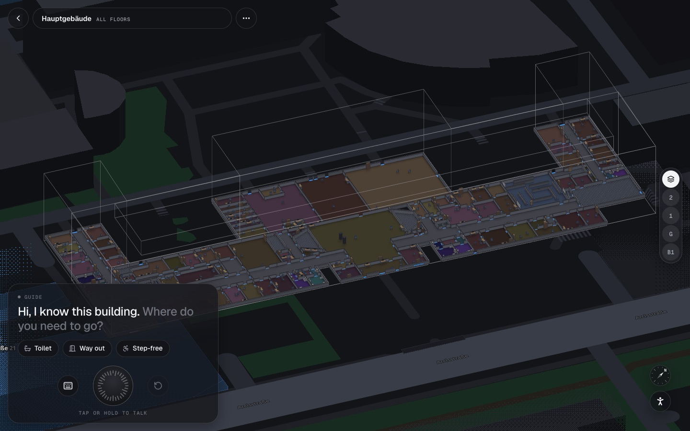
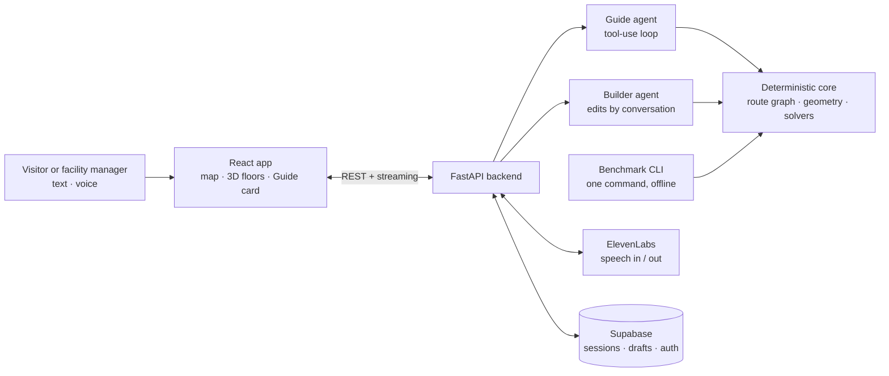
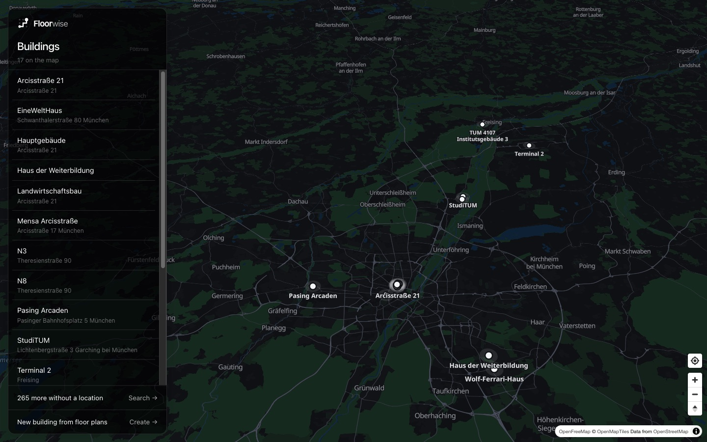

<div align="center">


# Floorwise

**Talk to your building.**

An indoor guide you can ask where things are, how to get there and what changes when a lift closes,
by typing or by voice. A deterministic geometry and route-graph core computes every answer. The language
model only handles the conversation.

[](https://floorwise-app.vercel.app)
&nbsp;
[](#run-it-locally)
&nbsp;
[](#tech-stack)
&nbsp;
[](#context)

<a href="https://floorwise-app.vercel.app"></a>

</div>

---

## Result

Benchmark scores from the official scorer (`benchmark/score.py`, unchanged):

| | Result |
|---|---:|
| Dev benchmark questions | **138 / 138** |
| Train + dev routes reproduced exactly (length and path) | **1,338 / 1,338** |
| Public test set answered, no errors | **145 / 145** |
| Organisers' internal evaluation set (252 auto-scored questions, after the event) | **0.885** |
| Kit buildings that load, route and render in the app | **280** |

Every number in an answer comes from code. The model never states a room, a distance, a count or a route
that a tool did not return, and a grounding check after every agent turn enforces this in code as well as in the prompt.

## The problem

The organisers provided 280 real buildings (campuses, factories, offices, hospitals) as floor plans:
rooms, doors with widths, stairs, lifts and equipment. The task was an agent that a person can simply *talk
to* about one of them:

- *"Where is the nearest toilet?"*, *"Which room has the 3D printer?"*
- *"Take me to lab 2.14 without stairs. I'm pushing a trolley."*
- *"The east lift is closed. What can't I reach any more?"*
- *"Add a door between these two rooms."*

The answers have to be right to the centimetre. A benchmark compares every route length and path with the
organisers' reference, so a language model that estimates the answer fails.

## How it works



- **One core, three consumers.** The conversational Guide, the Builder and the one-command benchmark runner
  all call the same Python core (`core/`). The UI and the benchmark use the same code to answer.
- **The route model matches the organisers' to the centimetre.** Nodes are room anchors and doors. Edges are walks inside a room (a
  visibility graph 15 cm off the walls), stairs and lifts, with Dijkstra over a networkx multigraph.
- **Constraints are graph filters.** Step-free, closures, minimum door width (wheelchair, trolley, forklift)
  remove edges. Routing profiles change those parameters. The algorithm stays the same.
- **Code writes the answer.** For the benchmark, a template parser maps the question to a solver
  kind. Only wording no template matches goes to an LLM, which fills slots from the building's own vocabulary.
  Code writes the final `Answer:` line.
- **Directions a person can follow.** Turns at the door you came through, a landmark near each door
  ("past the printers"), rounded metres, one line per lift or stair ride.
- **Edits are proposed, then confirmed.** A facility manager can close an area, rename a room or add a door
  by voice or chat. Nothing changes until they confirm, and every visitor's next route reflects the change.

Full write-up: [technical explanation (PDF)](docs/submission/technical-explanation.pdf) ·
benchmark command and formats: [SUBMISSION/BENCHMARK.md](SUBMISSION/BENCHMARK.md) ·
architecture: [docs/architecture/overview.md](docs/architecture/overview.md).

<p align="center"></p>

## Features

- **Ask in plain words**, typed or spoken (ElevenLabs Scribe for speech to text, Flash v2.5 for the voice,
  browser speech as a fallback).
- **Map to building:** 17 buildings with a real position on a MapLibre map, all 280 searchable. Opening one
  flies into stacked 3D floors (three.js) with an animated route and a step-by-step guide.
- **Routes per person:** step-free, no lifts, wide doors for trolleys and forklifts, closures.
- **Buildings from floor plans:** import one plan per floor, trace it, fit it onto the OpenStreetMap footprint
  and place it on the map.
- **Shared edits** with a version check, stored in Postgres (Supabase), with sign-in for managers.

## Tech stack

| Layer | Tools |
|---|---|
| Frontend | React 19, TypeScript, Vite, three.js / react-three-fiber, MapLibre GL |
| Backend | FastAPI, Python 3.12, deployed on Vercel |
| Core | networkx (route graph), shapely (geometry) |
| Agents | Claude (Anthropic API) or OpenAI, chosen with `LLM_PROVIDER` |
| Voice | ElevenLabs Scribe Realtime and Flash v2.5 |
| Data | Supabase (Postgres + Auth) |

## Run it locally

You need Python ≥ 3.12, [uv](https://docs.astral.sh/uv/), Node.js and an OpenAI or Anthropic API key. The kit's
dataset is committed in `data/`.

```bash
git clone https://github.com/utkukalkanli/industrial-agents-hackathon.git
cd industrial-agents-hackathon
uv sync
cp .env.example .env               # add OPENAI_API_KEY (or ANTHROPIC_API_KEY + LLM_PROVIDER=anthropic)

uv run pytest -q                   # offline test suite
```

The app (backend + frontend):

```bash
GUIDE_LLM=offline uv run uvicorn backend.app:app --port 8765    # no key needed; drop GUIDE_LLM for the real model
cd frontend/app && npm install && npx vite --port 5181          # open http://localhost:5181
```

The benchmark:

```bash
# Score our agent on the dev split with the official scorer
uv run --env-file .env python -m benchmark.evaluate data/dev --agent agent.answer:answer

# One command: building (or split) directory + questions file → answers file
uv run python -m agent.run_benchmark_v1 data/test data/test/questions.csv /tmp/answers.json
```

`PARSER_MODE=regex` runs it fully offline (template parser only). All commands: [docs/guides/commands.md](docs/guides/commands.md).

## Repository map

| Path | What |
|---|---|
| `core/` | Route graph, geometry, solvers, directions, edits and validation |
| `agent/` | Guide, Builder and Creator agents, question parsing, benchmark runner |
| `backend/` | FastAPI app: chat streaming, sessions, voice, access, persistence |
| `frontend/app/` | React app: map, building view, Guide card, plan editor |
| `benchmark/` | Official scorer and evaluator from the organisers' kit (never edited) |
| `data/` | Kit dataset: 280 buildings in train / dev / test |
| `SUBMISSION/` | Benchmark command and our test-set answers |
| `docs/`, `memory-bank/` | Knowledge base, decisions and project log ([start here](docs/README.md)) |
| `tests/` | Pytest suite |
| `archive/initial-repo/` | The rest of the organisers' starter kit, kept for reference |

## Context

Built at the **Industrial Agents Hackathon 2026**, Track 01 (Synera): *Talk to Your Building*. The repo
started from the organisers' starter kit. The brief is in [docs/challenge/brief.md](docs/challenge/brief.md).

**Team:** Atahan Kılıç · Utku Kalkanlı

## Licence

Our code is MIT ([LICENSE](LICENSE)). Kit code and data keep their own terms: see [NOTICE.md](NOTICE.md),
[ATTRIBUTION.md](ATTRIBUTION.md) and [data/README.md](data/README.md). Anything derived from the OpenStreetMap
buildings stays under the ODbL and credits © OpenStreetMap contributors.
